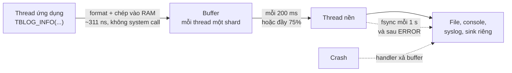

# tblog


Thư viện log bất đồng bộ cho C và C++ (Linux, macOS, Windows). Thread gọi log chỉ format dòng rồi chép vào RAM; một thread nền ghi file. Khi chương trình crash, phần còn trong RAM vẫn được ghi ra file.



Chi tiết từng bước, double buffer, độ bền và trình tự crash: [architecture.md](docs/architecture.md).

## Nên dùng / không nên dùng

So với `fprintf` vào một file, cùng dòng log ([benchmarks.md](docs/benchmarks.md); Windows 11, Ryzen 7 8845HS, NVMe, MinGW g++ 15 `-O2`):

| | `fprintf` | tblog | Kết luận |
|---|---|---|---|
| Lệnh log, p50 / p99, 1 thread | 2.03 µs / 6.9 µs | 311 ns / 591 ns | tblog nhanh hơn 6.5× |
| Lệnh log, p50 / p99, 8 thread | 8.56 µs / 330 µs | 561 ns / 671 ns | p99 thấp hơn 490×: không tranh khóa |
| Thông lượng tới khi đã fsync, 8 thread | 213 k dòng/s | 4.34 M dòng/s | 20× |
| Mất dòng khi SIGSEGV (TB / max, 20 lần) | 24 / 41 | 0 / 0 | crash handler xả buffer |
| Mất dòng khi `kill -9`, 4 thread | 22 / 41 | 4 612 / 7 751 | **tblog kém hơn**; bật `flush.on_level = ERROR` thì 0 dòng mất tới dòng ERROR cuối |
| RAM | 4 KB | 8 MB (mặc định) | tblog tốn hơn |

- **Nên dùng** khi thread làm việc không được chậm vì log, có nhiều thread cùng log, hoặc cần log còn nguyên khi crash.
- **Không cần** nếu chương trình một thread, log ít: `snprintf` + `fwrite` chỉ chậm hơn tblog 20% (381 so với 311 ns). Trên glibc / MSVC, `fprintf` có thể còn nhanh hơn: chưa đo.
- **Cân nhắc** nếu process hay bị `kill -9` và cần **từng** dòng cuối: `fprintf` + `fflush` mỗi dòng mất 0 dòng nhưng chậm 16× (4.95 µs mỗi lệnh).

## Bắt đầu nhanh

```c
#include <tblog/log.h>

int main(void) {
    tblog_init("log.conf");                 /* NULL = cấu hình mặc định */
    TBLOG_INFO("user %d logged in", 42);
    TBLOG_MWARN("network", "retry %d", 3);  /* log theo module */
    tblog_shutdown();                       /* ghi nốt buffer, fsync */
    return 0;
}
```

```cpp
#include <tblog/tblog.hpp>                  // header-only, C++11

int main() {
    tblog_init("log.conf");
    TBLOGF_INFO("user {} from {}", 42, "10.0.0.7");
    tblog::Logger net("network");
    net.info("connected to {}:{}", "example.org", 443);
    tblog_shutdown();
}
```

Dòng log mặc định:

```
2026-11-16 12:47:56.829576 [INFO] [81148] main.c:5 - user 42 logged in
```

## Tích hợp

```cmake
find_package(tblog 0.1 REQUIRED)          # bản đã cài
# hoặc: add_subdirectory(third_party/tblog) / FetchContent
target_link_libraries(app PRIVATE tblog::tblog)
```

pkg-config: `cc app.c $(pkg-config --cflags --libs tblog)`. Tĩnh / động, option CMake, Makefile: [build.md](docs/build.md).

## Cấu hình

Không có file cấu hình: log `INFO` trở lên vào `./logs/app.log`, xoay ở 256 MB, giữ 5 file. Ví dụ cho dịch vụ:

```ini
level          = INFO
file.path      = /var/log/myservice/app.log
file.rotate    = daily
file.max_files = 31
flush.on_level = ERROR      # dòng lỗi sống sót qua kill -9
module.network = DEBUG
```

File được đọc lại khi đổi (level, module, pattern...). Mọi key kèm ưu nhược và số đo: [configuration.md](docs/configuration.md).

## Nền tảng

| Nền tảng | Compiler | CI |
|---|---|---|
| Linux x86-64 (glibc, musl) | GCC, Clang | Đầy đủ, ASan+UBSan, TSan |
| macOS 12+ (arm64, x86_64) | AppleClang | Đầy đủ, ASan+UBSan, TSan |
| Windows 8+ x64 | MSVC (C++14+), MinGW-w64 | Đầy đủ |
| Windows ARM64 | MSVC | Chỉ biên dịch header |

Ứng dụng: C99 (MSVC: C11) hoặc C++11 trở lên. CMake 3.10+; zlib tùy chọn (nén gzip). Vi điều khiển: [tblog-lite](docs/lite.md) (C99, không malloc, ~3 KB code).

## Tài liệu

| File | Nội dung |
|---|---|
| [configuration.md](docs/configuration.md) | Mọi key, lựa chọn nào đổi gì lấy gì, cấu hình mẫu |
| [api.md](docs/api.md) | API C, API C++, sink riêng, thread-safety |
| [architecture.md](docs/architecture.md) | Các quyết định thiết kế và lý do, độ bền khi crash |
| [benchmarks.md](docs/benchmarks.md) | Số đo đầy đủ, cách đo, cách chạy lại |
| [build.md](docs/build.md) | Build, cài đặt, dùng từ project khác |
| [platforms.md](docs/platforms.md) | Khác biệt giữa Linux, macOS, Windows |
| [testing.md](docs/testing.md) | Chạy test, CI |
| [lite.md](docs/lite.md) | tblog-lite cho vi điều khiển |
| [CHANGELOG.md](CHANGELOG.md) | Thay đổi |

MIT, xem [LICENSE](LICENSE).
