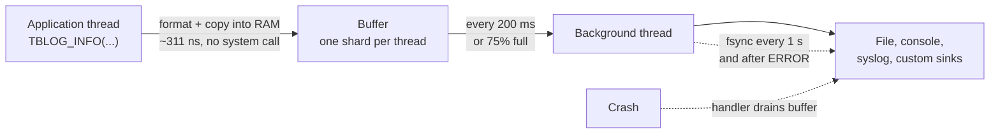

# tblog

**English** | [Tiếng Việt](README.vi.md)


Asynchronous logging library for C and C++ (Linux, macOS, Windows). The calling thread only formats the line and copies it into RAM; a background thread writes the file. When the program crashes, whatever is still in RAM is still written to the file.



Each step in detail, double buffering, durability and the crash sequence: [architecture.md](docs/architecture.md).

## When to use it / when not to

Compared with `fprintf` to a single file, same log line, measured on Linux (glibc), macOS, Windows MSVC (GitHub Actions, 3–4 CPUs) and Windows MinGW (16-CPU laptop). Ranges go from the best to the worst platform ([benchmarks.md](docs/benchmarks.md)):

| | `fprintf` | tblog | Verdict |
|---|---|---|---|
| Log call p50, 1 thread | 321–381 ns (MinGW: 2.03 µs) | 230–311 ns | 1.3–1.7× faster (MinGW: 6.5×) |
| Log call p99, 4 threads | 34–139 µs | 0.48–1.8 µs | 50–200× lower: no lock contention |
| Throughput until fsynced, 4 threads | 213–734 k lines/s | 1.5–6.4 M lines/s | 2.5–13× |
| Lines lost on SIGSEGV, `abort`, stack overflow (mean / max, 20 runs) | up to 28 / 41 | 0 | Crash handler drains the buffer |
| Lines lost on `kill -9`, 4 threads | up to 25 / 41 | 4 612–15 072 / up to 23 457 | **tblog is worse**; `flush.on_level = ERROR`: 0 lines lost up to the last ERROR line |
| RAM | 4 KB | 8 MB (default) | tblog uses more |

- **Use it** when many threads log at once, worker threads must not slow down because of logging, or the log must survive a crash intact.
- **Not needed** for a single-threaded program that logs little: on Linux / macOS, `fprintf` is only 1.3× slower at p50 and 1.5–1.6× slower in throughput.
- **Think twice** if the process is often `kill -9`'d and you need **every** last line: `fprintf` + `fflush` per line loses 0 lines but is 6–16× slower (1.42–4.95 µs per call).

## Quick start

```c
#include <tblog/log.h>

int main(void) {
    tblog_init("log.conf");                 /* NULL = default configuration */
    TBLOG_INFO("user %d logged in", 42);
    TBLOG_MWARN("network", "retry %d", 3);  /* per-module log */
    tblog_shutdown();                       /* write the rest of the buffer, fsync */
    return 0;
}
```

```cpp
#include <tblog/tblog.hpp>                  // header-only, C++11

int main() {
    tblog_init("log.conf");
    TBLOGF_INFO("user {} from {}", 42, "10.0.0.7");
    tblog::Logger net("network");
    net.info("connected to {}:{}", "example.org", 443);
    tblog_shutdown();
}
```

Default log line:

```
2026-11-16 12:47:56.829576 [INFO] [81148] main.c:5 - user 42 logged in
```

## Integration

```cmake
find_package(tblog 0.1 REQUIRED)          # installed copy
# or: add_subdirectory(third_party/tblog) / FetchContent
target_link_libraries(app PRIVATE tblog::tblog)
```

pkg-config: `cc app.c $(pkg-config --cflags --libs tblog)`. Static / shared, CMake options, Makefile: [build.md](docs/build.md).

## Configuration

With no configuration file: `INFO` and above go to `./logs/app.log`, rotated at 256 MB, 5 files kept. Example for a service:

```ini
level          = INFO
file.path      = /var/log/myservice/app.log
file.rotate    = daily
file.max_files = 31
flush.on_level = ERROR      # error lines survive kill -9
module.network = DEBUG
```

The file is re-read when it changes (level, modules, pattern...). Every key with its trade-offs and measurements: [configuration.md](docs/configuration.md).

## Platforms

| Platform | Compiler | CI |
|---|---|---|
| Linux x86-64 (glibc, musl) | GCC, Clang | Full, ASan+UBSan, TSan |
| macOS 12+ (arm64, x86_64) | AppleClang | Full, ASan+UBSan, TSan |
| Windows 8+ x64 | MSVC (C++14+), MinGW-w64 | Full |
| Windows ARM64 | MSVC | Headers compiled only |

Applications: C99 (MSVC: C11) or C++11 and later. CMake 3.10+; zlib optional (gzip compression). Microcontrollers: [tblog-lite](docs/lite.md) (C99, no malloc, ~3 KB code).

## Documentation

| File | Contents |
|---|---|
| [configuration.md](docs/configuration.md) | Every key, what each choice trades for what, sample configurations |
| [api.md](docs/api.md) | C API, C++ API, custom sinks, thread safety |
| [architecture.md](docs/architecture.md) | Design decisions and their reasons, crash durability |
| [benchmarks.md](docs/benchmarks.md) | Full measurements, method, how to rerun |
| [build.md](docs/build.md) | Building, installing, using from another project |
| [platforms.md](docs/platforms.md) | Differences between Linux, macOS, Windows |
| [testing.md](docs/testing.md) | Running the tests, CI |
| [lite.md](docs/lite.md) | tblog-lite for microcontrollers |
| [CHANGELOG.md](CHANGELOG.md) | Changes |

Vietnamese documentation: [README.vi.md](README.vi.md), [docs/vi/](docs/vi/).

MIT, see [LICENSE](LICENSE).
