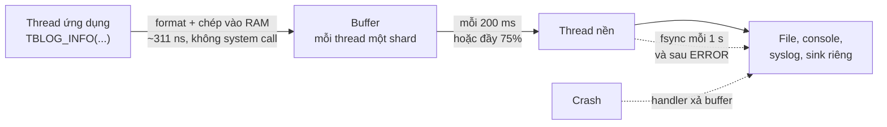

# tblog

[English](README.md) | **Tiếng Việt**


Thư viện log bất đồng bộ cho C và C++ (Linux, macOS, Windows). Thread gọi log chỉ format dòng rồi chép vào RAM; một thread nền ghi file. Khi chương trình crash, phần còn trong RAM vẫn được ghi ra file.



Chi tiết từng bước, double buffer, độ bền và trình tự crash: [architecture.md](docs/vi/architecture.md).

## Nên dùng / không nên dùng

So với `fprintf` vào một file, cùng dòng log, đo trên Linux (glibc), macOS, Windows MSVC (GitHub Actions, 3–4 CPU) và Windows MinGW (laptop 16 CPU). Khoảng giá trị là từ nền tảng tốt nhất tới kém nhất ([benchmarks.md](docs/vi/benchmarks.md)):

| | `fprintf` | tblog | Kết luận |
|---|---|---|---|
| Lệnh log p50, 1 thread | 321–381 ns (MinGW: 2.03 µs) | 230–311 ns | Nhanh hơn 1.3–1.7× (MinGW: 6.5×) |
| Lệnh log p99, 4 thread | 34–139 µs | 0.48–1.8 µs | Thấp hơn 50–200×: không tranh khóa |
| Thông lượng tới khi đã fsync, 4 thread | 213–734 k dòng/s | 1.5–6.4 M dòng/s | 2.5–13× |
| Mất dòng khi SIGSEGV, `abort`, tràn stack (TB / max, 20 lần) | tới 28 / 41 | 0 | Crash handler xả buffer |
| Mất dòng khi `kill -9`, 4 thread | tới 25 / 41 | 4 612–15 072 / tới 23 457 | **tblog kém hơn**; `flush.on_level = ERROR`: 0 dòng mất tới dòng ERROR cuối |
| RAM | 4 KB | 8 MB (mặc định) | tblog tốn hơn |

- **Nên dùng** khi có nhiều thread cùng log, thread làm việc không được chậm vì log, hoặc cần log còn nguyên khi crash.
- **Không cần** nếu chương trình một thread, log ít: trên Linux / macOS, `fprintf` chỉ chậm hơn 1.3× ở p50 và 1.5–1.6× về thông lượng.
- **Cân nhắc** nếu process hay bị `kill -9` và cần **từng** dòng cuối: `fprintf` + `fflush` mỗi dòng mất 0 dòng nhưng chậm 6–16× (1.42–4.95 µs mỗi lệnh).

## Bắt đầu nhanh

```c
#include <tblog/log.h>

int main(void) {
    tblog_init("log.conf");                 /* NULL = cấu hình mặc định */
    TBLOG_INFO("user %d logged in", 42);
    TBLOG_MWARN("network", "retry %d", 3);  /* log theo module */
    tblog_shutdown();                       /* ghi nốt buffer, fsync */
    return 0;
}
```

```cpp
#include <tblog/tblog.hpp>                  // header-only, C++11

int main() {
    tblog_init("log.conf");
    TBLOGF_INFO("user {} from {}", 42, "10.0.0.7");
    tblog::Logger net("network");
    net.info("connected to {}:{}", "example.org", 443);
    tblog_shutdown();
}
```

Dòng log mặc định:

```
2026-11-16 12:47:56.829576 [INFO] [81148] main.c:5 - user 42 logged in
```

## Tích hợp

```cmake
find_package(tblog 0.1 REQUIRED)          # bản đã cài
# hoặc: add_subdirectory(third_party/tblog) / FetchContent
target_link_libraries(app PRIVATE tblog::tblog)
```

pkg-config: `cc app.c $(pkg-config --cflags --libs tblog)`. Tĩnh / động, option CMake, Makefile: [build.md](docs/vi/build.md).

## Cấu hình

Không có file cấu hình: log `INFO` trở lên vào `./logs/app.log`, xoay ở 256 MB, giữ 5 file. Ví dụ cho dịch vụ:

```ini
level          = INFO
file.path      = /var/log/myservice/app.log
file.rotate    = daily
file.max_files = 31
flush.on_level = ERROR      # dòng lỗi sống sót qua kill -9
module.network = DEBUG
```

File được đọc lại khi đổi (level, module, pattern...). Mọi key kèm ưu nhược và số đo: [configuration.md](docs/vi/configuration.md).

## Nền tảng

| Nền tảng | Compiler | CI |
|---|---|---|
| Linux x86-64 (glibc, musl) | GCC, Clang | Đầy đủ, ASan+UBSan, TSan |
| macOS 12+ (arm64, x86_64) | AppleClang | Đầy đủ, ASan+UBSan, TSan |
| Windows 8+ x64 | MSVC (C++14+), MinGW-w64 | Đầy đủ |
| Windows ARM64 | MSVC | Chỉ biên dịch header |

Ứng dụng: C99 (MSVC: C11) hoặc C++11 trở lên. CMake 3.10+; zlib tùy chọn (nén gzip). Vi điều khiển: [tblog-lite](docs/vi/lite.md) (C99, không malloc, ~3 KB code).

## Tài liệu

| File | Nội dung |
|---|---|
| [configuration.md](docs/vi/configuration.md) | Mọi key, lựa chọn nào đổi gì lấy gì, cấu hình mẫu |
| [api.md](docs/vi/api.md) | API C, API C++, sink riêng, thread-safety |
| [architecture.md](docs/vi/architecture.md) | Các quyết định thiết kế và lý do, độ bền khi crash |
| [benchmarks.md](docs/vi/benchmarks.md) | Số đo đầy đủ, cách đo, cách chạy lại |
| [build.md](docs/vi/build.md) | Build, cài đặt, dùng từ project khác |
| [platforms.md](docs/vi/platforms.md) | Khác biệt giữa Linux, macOS, Windows |
| [testing.md](docs/vi/testing.md) | Chạy test, CI |
| [lite.md](docs/vi/lite.md) | tblog-lite cho vi điều khiển |
| [CHANGELOG.vi.md](CHANGELOG.vi.md) | Thay đổi |

Bản tiếng Anh: [README.md](README.md), [docs/](docs/).

MIT, xem [LICENSE](LICENSE).
