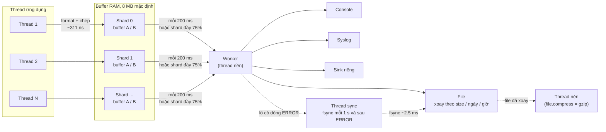
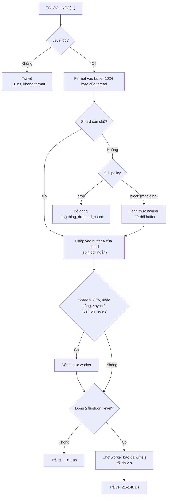
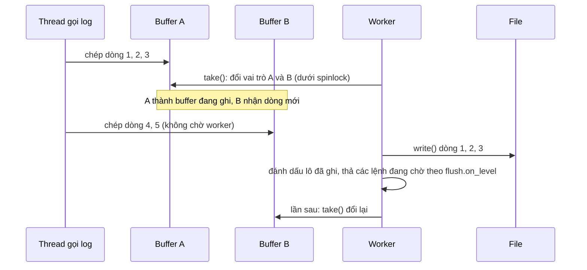
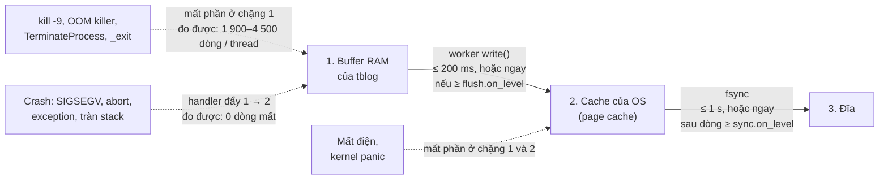
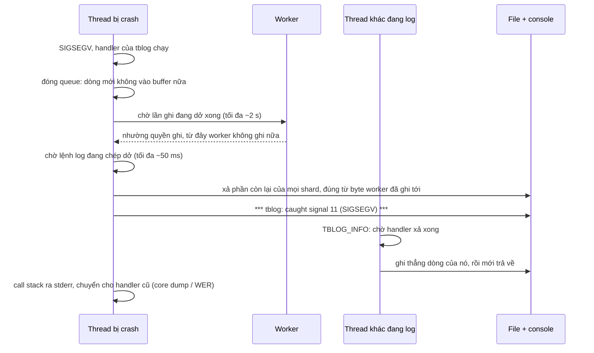

# Kiến trúc

Số đo dưới đây lấy từ laptop Windows 11 (Ryzen 7 8845HS, NVMe), trừ khi ghi rõ Linux / macOS (GitHub Actions) ([benchmarks.md](benchmarks.md)).

## Tổng quan



- Thread ứng dụng chỉ làm việc trong RAM: không system call, không cấp phát.
- Mỗi thread gắn cố định một shard (gán vòng tròn), nên dòng của một thread luôn đúng thứ tự.
- Một worker ghi mọi sink. fsync và nén chạy trên thread riêng để không chặn worker.

## Đường đi của một lệnh log



## Double buffer trong một shard



Thread gọi log chỉ giữ spinlock trong lúc chép một dòng; việc ghi ra đĩa luôn diễn ra trên buffer kia, nên đĩa chậm không chặn thread gọi log, trừ khi cả buffer đang nhận cũng đầy (lúc đó áp dụng `full_policy`).

## Các quyết định thiết kế

### 1. Ghi bất đồng bộ

Thread gọi log không gọi system call; một thread nền ghi file.

- **Ưu**: lệnh log 311 ns p50 so với 2.03 µs của `fprintf` (1 thread). Đĩa chậm không làm chậm ứng dụng.
- **Nhược**: `kill -9` mất phần còn trong RAM: tới 1 900–4 500 dòng mỗi thread tùy số CPU (6 725 trên macOS VM), so với 41 của `fprintf`. Thêm 2–3 thread và 8 MB RAM. Có `flush.on_level` để bù cho dòng quan trọng ([configuration.md](configuration.md#flushon_level-sống-sót-qua-kill--9)).

### 2. Buffer chia shard theo thread

N shard (lũy thừa của 2 ≥ số CPU, tối đa 16), mỗi thread gắn cố định một shard, mỗi shard một spinlock và hai buffer.

- **Ưu**: các thread gần như không tranh nhau. Thông lượng tăng theo số thread (1.89 M → 4.34 M dòng/s từ 1 lên 8 thread), p99 giữ dưới 1 µs. `fprintf` dùng chung một `FILE*` thì giảm (365 k → 213 k) và p99 lên 330 µs.
- **Nhược**: dòng của các thread khác nhau có thể lệch thứ tự thời gian tối đa khoảng một `flush.interval_ms`. Dòng của cùng một thread luôn đúng thứ tự.

### 3. Format trên thread gọi log

- **Ưu**: đối số không cần sống sau khi lệnh trả về; lỗi format hiện ngay trong dòng. Tổng chi phí cả format là 311 ns p50.
- **Nhược**: thread gọi log trả tiền format. Chế độ format trì hoãn từng có nhưng đã bỏ để đơn giản hóa.

### 4. Một thread nền ghi mọi sink

- **Ưu**: thứ tự ghi đơn giản, không khóa giữa các sink.
- **Nhược**: trần khoảng 4–5 M dòng/s: ở 16 thread, các thread đưa được 18.3 M dòng/s vào buffer nhưng chỉ 4.27 M dòng/s ra file. Một sink chậm (console, syslog, sink riêng) làm chậm tất cả.

### 5. fsync trên thread riêng

- **Ưu**: một fsync tốn khoảng 2.5 ms; nếu chạy trên worker, mỗi lần fsync worker ngừng đổi buffer. Tách ra thì lệnh log không bao giờ chờ fsync.
- **Nhược**: thêm một thread. Trên Windows, `WriteFile` vẫn phải chờ `FlushFileBuffers` đang chạy trên cùng file, nên `flush.on_level` + `sync.on_level` cùng level làm mỗi dòng ERROR chờ cả fsync (2.69–5.4 ms thay vì 21–148 µs). Linux và macOS tách được hẳn: cùng cấu hình chỉ 39 / 37 µs p50.

### 6. Crash handler xả buffer

Handler bắt SIGSEGV, SIGABRT, SIGBUS, SIGFPE, SIGILL (Windows: SEH, `abort`), chờ lần ghi đang dở của worker xong, rồi xả phần còn lại vào file và console. Dòng log của thread khác sau lúc đó được ghi thẳng vào file trước khi lệnh trả về.

- **Ưu**: 0 dòng mất, 0 dòng lặp ở mọi kịch bản crash, kể cả khi 4 thread khác vẫn đang log (20 lần mỗi kịch bản). `fprintf` mất trung bình 24 dòng và để lại dòng cụt.
- **Nhược**:
  - Process chết chậm hơn: 1.2 so với 0.7 ms (Linux), 2.4 so với 1.6 ms (laptop Windows), tới 10.3 so với 1.5 ms khi 4 thread khác đang log.
  - Chỉ xả vào file và console, vì syslog và sink riêng không an toàn trong signal handler.
  - Linux / macOS: tràn stack chỉ báo được khi thread có alternate signal stack. tblog cấp cho mỗi thread một stack 64 KB ở lệnh log đầu tiên của nó (một `mmap`, chưa tốn RAM thật tới khi có signal, gỡ khi thread kết thúc). Trước khi có việc này, tràn stack trên thread phụ mất cả buffer (TB 2 065 dòng trên Linux, 2 794 trên macOS); giờ là 0. Thread chưa từng log thì vẫn không được bảo vệ.

## Độ bền theo tình huống

Một dòng log đi qua ba chặng. Sự cố nào cũng chỉ làm mất phần **chưa qua** chặng tương ứng:



| Tình huống | Kết quả |
|---|---|
| `tblog_shutdown()`, `exit()`, `return` từ `main` | Đủ: ghi mọi sink, fsync |
| `tblog_flush()` trả về | Mọi dòng trước đó đã ghi và fsync |
| Crash handler bắt được | Mọi dòng đã trả về có trong file và console, đúng một lần |
| `TBLOG_FATAL` | Ghi, fsync, rồi `abort()` |
| `kill -9`, OOM killer, `TerminateProcess`, `_exit` | Mất phần còn trong buffer; dòng ≥ `flush.on_level` đã trả về thì không |
| Mất điện | Mất phần chưa fsync: tối đa ≈ `sync.interval_ms` + `flush.interval_ms` |

Giới hạn của crash handler (đều có chặn thời gian, không bao giờ treo): worker kẹt quá ~2 s giữa lúc ghi thì phần đầu chunk đó có thể bị lặp; tràn stack trên một thread chưa từng log (Linux / macOS: thread đó chưa có alternate stack) thì handler không chạy được, mất cả buffer như `kill -9`. Cơ chế chi tiết nằm trong chú thích "Crash safety" và "Waiting for the write" của `src/queue/queue.cpp`.

## Trình tự khi crash



Nhờ bước chờ worker và đọc đúng vị trí đã ghi, không dòng nào bị mất hay lặp; nhờ thread khác ghi thẳng sau khi handler xong, dòng log trong vài ms process còn đang chết cũng không mất (đo được: 0 dòng mất trong cả 20 lần thử, 4 thread đang log).

## Crash handling theo nền tảng

| | Linux / macOS | Windows |
|---|---|---|
| Bắt | SIGSEGV, SIGABRT, SIGBUS, SIGFPE, SIGILL | Unhandled-exception filter, `SIGABRT` |
| Dòng báo | `*** tblog: caught signal 11 (SIGSEGV) ***` | `*** tblog: caught exception 0xC0000005 (...) ***` |
| Call stack ra stderr | `backtrace_symbols_fd` (musl: không có) | Chỉ địa chỉ + base address của module |
| Sau đó | Handler cũ / core dump | Filter cũ / WER, debugger vẫn thấy |
| Tràn stack | Mọi thread đã log (alternate stack 64 KB cấp ở lệnh log đầu tiên): 0 dòng mất (20/20 lần). Thread chưa từng log: handler không chạy | Mọi thread: 0 dòng mất (20/20 lần) |

## Thoát process trên Windows

`tblog_init` đăng ký `tblog_shutdown` với `atexit()`.

- Bản tĩnh trong `.exe`: shutdown bình thường.
- `tblog.dll`: handler chạy lúc DLL bị gỡ, khi các thread khác đã bị dừng. tblog không join (sẽ treo) mà xả buffer vào file và console ngay trên thread đang thoát. Sink riêng không nhận các dòng cuối: hãy tự gọi `tblog_shutdown()` trước khi thoát.
- Không hỗ trợ `FreeLibrary(tblog.dll)` khi logger đang chạy.

## Mã nguồn

```
include/tblog/   log.h (API C), tblog.hpp + detail/format.hpp (API C++)
src/core/        level, module, formatter
src/queue/       buffer chia shard (đường nóng)
src/config/      parser, kiểm tra, hot-reload
src/logger/      API C, worker, thread sync, Pipeline (queue → sink)
src/crash/       nội dung báo crash
src/sinks/       file (xoay, nén), console, syslog, sink riêng
src/platform/    platform.h + posix/ + win32/
lite/            tblog-lite cho vi điều khiển
```

Mọi lời gọi OS nằm trong `src/platform/`; `packaging/check-platform-boundary.sh` (job CI `platform boundary`) báo lỗi nếu code khác include header của OS. Thêm nền tảng mới = thêm `src/platform/<os>/`.
