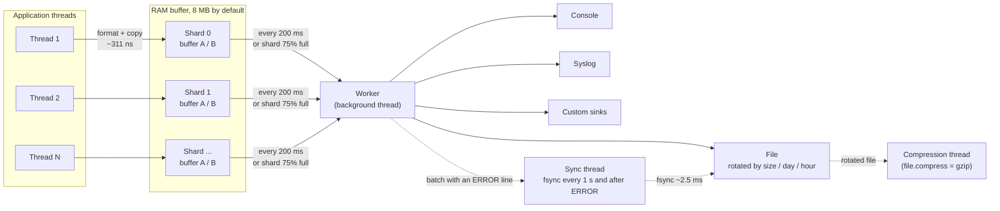
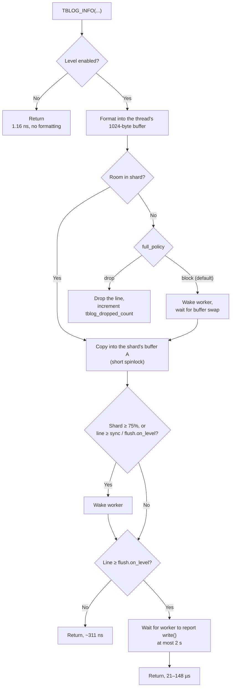
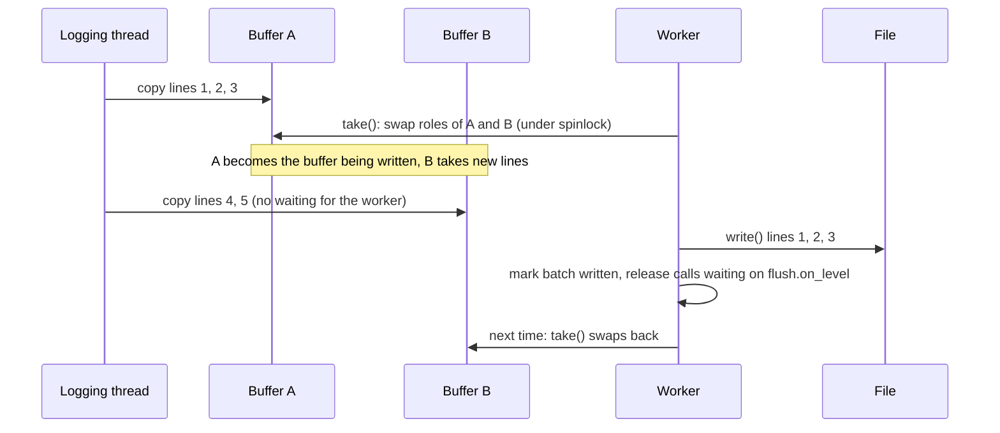
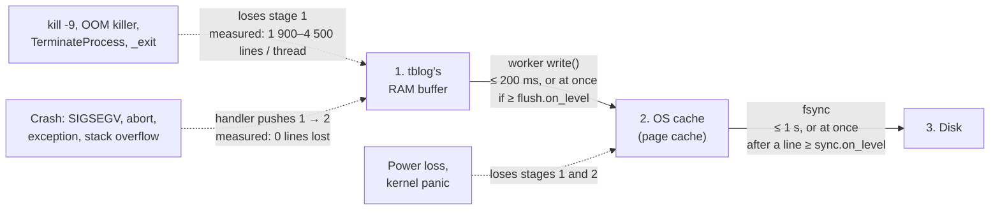
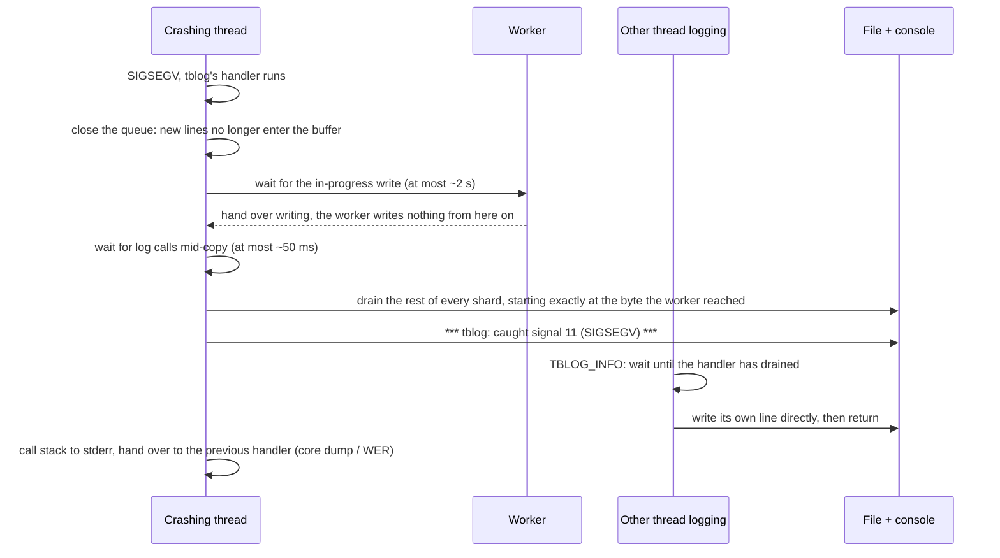

# Architecture

**English** | [Tiếng Việt](vi/architecture.md)

The figures below come from a Windows 11 laptop (Ryzen 7 8845HS, NVMe), unless Linux / macOS (GitHub Actions) is stated ([benchmarks.md](benchmarks.md)).

## Overview



- Application threads only work in RAM: no system calls, no allocation.
- Each thread is pinned to one shard (assigned round-robin), so a thread's lines are always in order.
- One worker writes every sink. fsync and compression run on their own threads so they do not block the worker.

## Path of a log call



## Double buffering inside a shard



The logging thread holds the spinlock only while copying one line; writing to disk always happens on the other buffer, so a slow disk does not block logging threads unless the receiving buffer is full too (then `full_policy` applies).

## Design decisions

### 1. Asynchronous writes

The logging thread makes no system calls; a background thread writes the file.

- **Pro**: a log call takes 311 ns p50 versus 2.03 µs for `fprintf` (1 thread). A slow disk does not slow the application.
- **Con**: `kill -9` loses whatever is still in RAM: up to 1 900–4 500 lines per thread depending on CPU count (6 725 on the macOS VM), versus 41 for `fprintf`. 2–3 extra threads and 8 MB of RAM. `flush.on_level` compensates for important lines ([configuration.md](configuration.md#flushon_level-surviving-kill--9)).

### 2. Buffer sharded by thread

N shards (power of 2 ≥ CPU count, at most 16), each thread pinned to one shard, each shard with one spinlock and two buffers.

- **Pro**: threads barely contend. Throughput scales with threads (1.89 M → 4.34 M lines/s from 1 to 8 threads), p99 stays under 1 µs. `fprintf` sharing one `FILE*` drops (365 k → 213 k) and p99 rises to 330 µs.
- **Con**: lines from different threads can be out of time order by up to about one `flush.interval_ms`. Lines from the same thread are always in order.
- The spinlock is held for one copy. `block` spins, yields, then sleeps (so a preempted lower-priority holder gets to run) and stops waiting once the queue is closed; `drop` gives up after a short spin and drops the line. A real-time thread therefore never spins forever behind a preempted or crashed holder.

### 3. Formatting on the logging thread

- **Pro**: arguments need not outlive the call; format errors show up in the line immediately. The total cost, formatting included, is 311 ns p50.
- **Con**: the logging thread pays for formatting. A deferred-formatting mode existed but was removed for simplicity.

### 4. One background thread writes every sink

- **Pro**: simple write ordering, no locking between sinks.
- **Con**: a ceiling of about 4–5 M lines/s: at 16 threads, the threads put 18.3 M lines/s into the buffer but only 4.27 M lines/s reach the file. One slow sink (console, syslog, custom sink) slows them all.

### 5. fsync on its own thread

- **Pro**: one fsync costs about 2.5 ms; on the worker, the worker would stop swapping buffers during each fsync. Split off, a log call never waits for fsync.
- **Con**: one more thread. On Windows, `WriteFile` still has to wait for a `FlushFileBuffers` running on the same file, so `flush.on_level` + `sync.on_level` at the same level makes every ERROR line wait for the fsync too (2.69–5.4 ms instead of 21–148 µs). Linux and macOS separate them fully: the same configuration costs only 39 / 37 µs p50.

### 6. Crash handler drains the buffer

The handler catches SIGSEGV, SIGABRT, SIGBUS, SIGFPE, SIGILL (Windows: SEH, `abort`), waits for the worker's in-progress write to finish, then drains the rest into the file and console. Log lines from other threads after that point are written straight to the file before the call returns.

- **Pro**: 0 lines lost, 0 lines duplicated in every crash scenario, even while 4 other threads keep logging (20 runs per scenario). `fprintf` loses a mean of 24 lines and leaves a truncated line.
- **Cons**:
  - The process dies more slowly: 1.2 vs 0.7 ms (Linux), 2.4 vs 1.6 ms (Windows laptop), up to 10.3 vs 1.5 ms while 4 other threads are logging.
  - Drains only into file and console, because syslog and custom sinks are not safe inside a signal handler.
  - Linux / macOS: a stack overflow can only be reported if the thread has an alternate signal stack. tblog gives each thread a 64 KB stack on its first log call (one `mmap`, no real RAM used until a signal, released when the thread exits). Before this, a stack overflow on a secondary thread lost the whole buffer (mean 2 065 lines on Linux, 2 794 on macOS); now it is 0. A thread that has never logged is still unprotected.

## Durability by scenario

A log line goes through three stages. Each failure only loses what has **not yet passed** the matching stage:



| Scenario | Result |
|---|---|
| `tblog_shutdown()`, `exit()`, `return` from `main` | Complete: every sink written, fsynced |
| `tblog_flush()` has returned | Every earlier line written and fsynced |
| Crash caught by the handler | Every line that returned is in the file and console, exactly once |
| `TBLOG_FATAL` | Write, fsync, then `abort()` |
| `kill -9`, OOM killer, `TerminateProcess`, `_exit` | Whatever is in the buffer is lost; lines ≥ `flush.on_level` that returned are not |
| Power loss | What was not fsynced is lost: at most ≈ `sync.interval_ms` + `flush.interval_ms` |

Limits of the crash handler (all time-bounded, it never hangs): if the worker is stuck for more than ~2 s mid-write, the start of that chunk may be duplicated; a stack overflow on a thread that has never logged (Linux / macOS: that thread has no alternate stack yet) prevents the handler from running, and the whole buffer is lost as with `kill -9`. The detailed mechanism is in the "Crash safety" and "Waiting for the write" comments in `src/queue/queue.cpp`.

## Crash sequence



Because the handler waits for the worker and reads from exactly the written position, no line is lost or duplicated; because other threads write directly once the handler is done, lines logged in the few ms while the process is dying are not lost either (measured: 0 lines lost in all 20 runs, 4 threads logging).

## Crash handling by platform

| | Linux / macOS | Windows |
|---|---|---|
| Catches | SIGSEGV, SIGABRT, SIGBUS, SIGFPE, SIGILL | Unhandled-exception filter, `SIGABRT` |
| Report line | `*** tblog: caught signal 11 (SIGSEGV) ***` | `*** tblog: caught exception 0xC0000005 (...) ***` |
| Call stack to stderr | `backtrace_symbols_fd` (musl: none) | Addresses + module base address only |
| Afterwards | Previous handler / core dump | Previous filter / WER, debuggers still see it |
| Stack overflow | Every thread that has logged (64 KB alternate stack allocated on its first log call): 0 lines lost (20/20 runs). Thread that never logged: handler does not run | Every thread: 0 lines lost (20/20 runs) |

## Process exit on Windows

`tblog_init` registers `tblog_shutdown` with `atexit()`.

- Static library in the `.exe`: normal shutdown.
- `tblog.dll`: the handler runs when the DLL is unloaded, after the other threads have been stopped. tblog does not join (that would hang) but drains the buffer into the file and console right on the exiting thread. Custom sinks do not receive the final lines: call `tblog_shutdown()` yourself before exiting.
- `FreeLibrary(tblog.dll)` while the logger is running is not supported.

## Source code

```
include/tblog/   log.h (C API), tblog.hpp + detail/format.hpp (C++ API)
src/core/        level, module, formatter
src/queue/       sharded buffer (hot path)
src/config/      parser, validation, hot reload
src/logger/      C API, worker, sync thread, Pipeline (queue → sink)
src/crash/       crash report contents
src/sinks/       file (rotation, compression), console, syslog, custom sinks
src/platform/    platform.h + posix/ + win32/
lite/            tblog-lite for microcontrollers
```

Every OS call lives in `src/platform/`; `packaging/check-platform-boundary.sh` (CI job `platform boundary`) fails if other code includes an OS header. A new platform = a new `src/platform/<os>/`.
